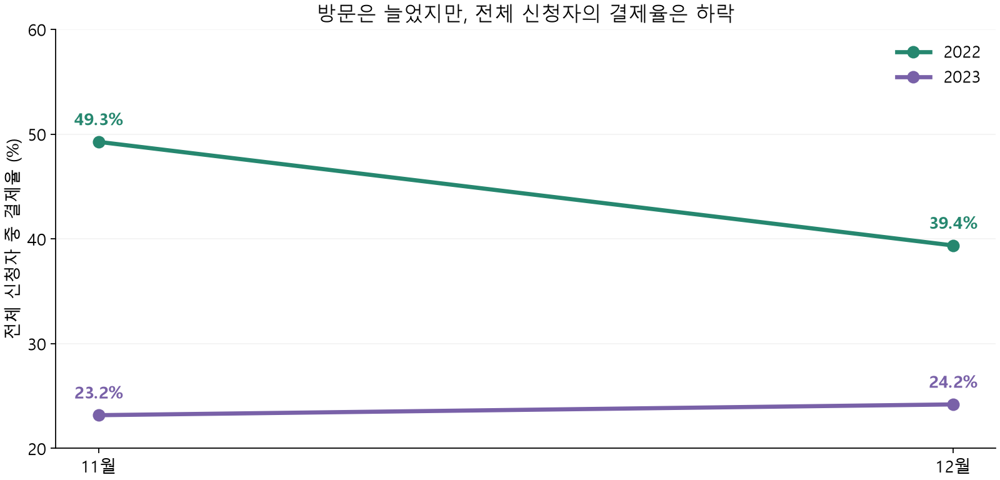
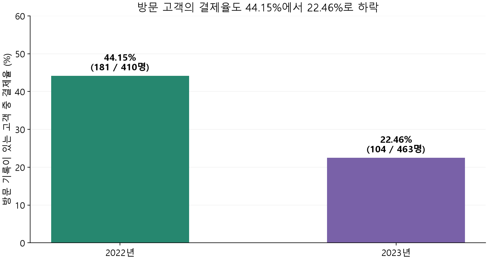

# 공유오피스 3일 무료체험 결제율 하락 분석

**이용 행동은 활발해졌는데 결제율은 낮아졌습니다. 행동·경쟁사 분석의 한계를 확인하고, 미결제 사유 조사 → 실험 → CRM을 제안했습니다.**

2인이 문제 정의부터 분석·해석·제안까지 전 과정을 함께 수행했습니다.

[분석 노트북 보기](office_payment_analysis.ipynb) · [지표 정의와 한계](metric_notes.md) · [집계 결과](aggregate_results.json)



## 문제와 분석 범위

- 비교 기간: 2022년 및 2023년 11~12월 신청 코호트
- 전체 신청자 1,144명: 2022년 617명 / 2023년 527명
- 방문 기록이 있는 고객 873명: 2022년 410명 / 2023년 463명
- 도구: Python, pandas, matplotlib, statsmodels
- 분석 질문: 방문 전환·방문일수·체류시간·이용 지점수의 차이만으로 결제율 하락을 설명할 수 있는가?

## 확인한 결과

| 지표 | 2022년 | 2023년 | 기준 |
|---|---:|---:|---|
| 11월 결제율 | 49.3% | 23.2% | 해당 월 전체 신청자 |
| 12월 결제율 | 39.4% | 24.2% | 해당 월 전체 신청자 |
| 방문 기록 보유율 | 66.45% | 87.86% | 11~12월 전체 신청자 |
| 방문자 결제율 | 44.15% | 22.46% | 방문 기록이 있는 신청자 |

방문일수와 평균 총체류시간은 높아졌지만, 같은 방문일수 구간에서도 2023년 결제율은 낮았습니다. 기본 로지스틱 회귀에서 행동 지표를 포함한 2023년 오즈비는 약 **0.374**였습니다(95% 신뢰구간 0.264~0.529, 방문 고객 873명).

오즈비는 확률 비율이나 인과효과가 아닙니다. 방문 기록의 관찰기간과 결제 전후 순서를 확정하지 못했으므로, 관련성이 남았다는 탐색적 결과로 해석했습니다.



## 경쟁사 검토에서 확인한 한계

가격·지점 접근성·프로모션을 검토했지만, 자료 시점이 분석 기간과 다르거나 고객별 실제 노출을 확인할 수 없었습니다. 예를 들어 2022년 개인 후기와 2024년 지점 관련 기사는 2023년 경쟁 상황을 직접 입증하지 못합니다. 따라서 경쟁사가 하락 원인이라고 결론 내리지 않았습니다.

## 후속 검증 제안


| 순서 | 제안 | 확인할 내용 |
|---|---|---|
| 1 | 미결제 사유 투표 | 가격·위치·서비스·이용 필요·경쟁사·상품 정보 등 복수 선택 후 가장 큰 이유 확인 |
| 2 | 응답과 로그 연결 | 같은 추적기간의 행동, 실제 결제일, 안내·혜택 노출 연결 |
| 3 | 안내 A/B 테스트 | 일반 안내와 행동 기반 개인화 안내의 상대 전환 효과 |
| 4 | 혜택 A/B 테스트 | 20% 할인과 비가격 혜택의 상대 효과 및 비용 |
| 5 | CRM 적용 | 검증된 대응안을 해당 고객군에 적용하고 전환·비용 지표 점검 |

투표·실험·CRM은 제안이며 실제 실행 성과로 기재하지 않습니다. 위치나 이용 필요 감소처럼 제안한 두 실험으로 확인하기 어려운 사유는 추가 조사가 필요합니다.

## 파일 구성

| 파일 | 내용 |
|---|---|
| `office_payment_analysis.ipynb` | 문제 정의 → 데이터 점검 → 지표 비교 → 회귀 → 해석·제안 |
| `analysis.py` | 입력 검증, 고객 단위 결합, 집계·회귀·그래프 생성 함수 |
| `aggregate_results.json` | 사용자별 기록을 제외한 재계산 결과 |
| `metric_notes.md` | 분자·분모, 기록 처리, 해석의 한계 |
| `changes.md` | 원본 노트북에서 공개본으로 정리한 내용 |
| `requirements.txt` | 검증에 사용한 주요 라이브러리 버전 |

## 실행 방법

공개 파일에는 고객별 원본 CSV가 포함되지 않습니다. 데이터 접근 권한이 있는 환경에서 아래 세 파일을 이 폴더의 `data/`에 두고 실행합니다. 파일 경로는 `OFFICE_DATA_DIR` 환경변수로도 지정할 수 있습니다.

```text
data/
  trial_register_dropduplicates.csv
  trial_payment_dropduplicates.csv
  trial_visit_info_dropduplicates.csv
```

```bash
python -m pip install -r requirements.txt
python analysis.py
```

또는 같은 폴더의 노트북을 위에서 아래로 실행합니다. 입력 데이터가 없으면 전체 재실행은 불가능하며, 공개된 집계 결과·그래프·실행된 노트북으로 분석 흐름을 확인할 수 있습니다.

기존 탐색 노트북 `프로젝트3`, `프로젝트3-1`, `프로젝트3-2`를 바탕으로 핵심 분석을 정리했습니다. 군집·생존 분석 등 추가 탐색은 핵심 결론의 근거에 포함하지 않았습니다. 원본의 일부 방문자 결제율 계산은 공개본에서 모집단을 맞춰 수정했습니다. 자세한 기준은 [지표 정의](metric_notes.md)를 참고하세요.
