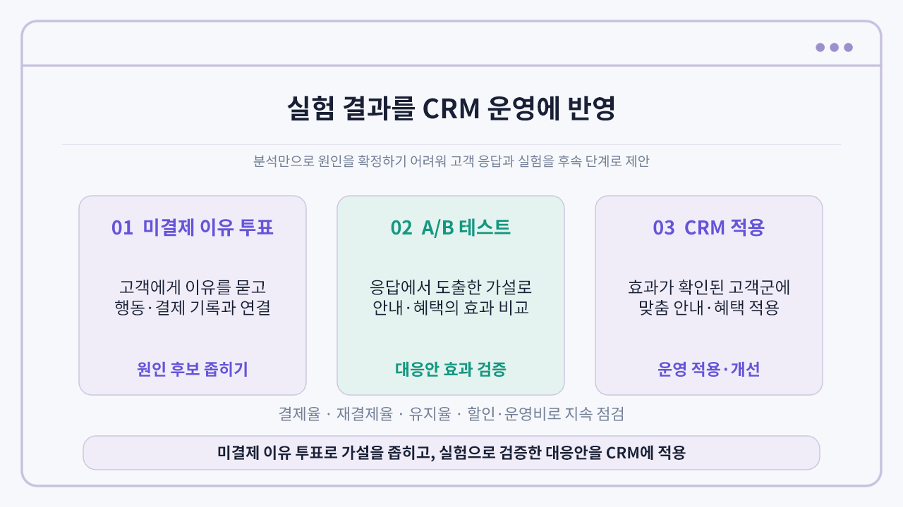

# 공유오피스 3일 무료체험 결제율 하락 분석

**행동 지표와 경쟁사 정황으로 결제율 하락 원인을 확정하기 어려워, 고객 응답 수집과 후속 실험을 제안한 프로젝트입니다.**

2인이 문제 정의부터 분석·결과 해석·제안까지 전 과정을 함께 수행했습니다.

## 문제와 분석 대상

2023년 11·12월 결제율은 전년 동월보다 각각 26.1%p, 15.2%p 낮았습니다. 방문과 이용 행동의 차이로 이 현상을 설명할 수 있는지 확인했습니다.

- 비교 기간: 2022년 및 2023년 11~12월
- 방문 고객: 873명, 2022년 410명과 2023년 463명
- 분석 항목: 방문 전환, 방문일수, 체류시간, 이용 지점수와 결제 여부

## 분석 과정과 확인한 결과

1. 첫 방문·재방문 전환율과 평균 방문일수·체류시간은 더 높아졌습니다.
2. 같은 방문일수 구간에서도 2023년 결제율은 더 낮았습니다.
3. 행동 지표를 보정한 로지스틱 회귀에서도 연도 차이가 남았습니다. 2023년 결제 오즈비는 약 0.374로, 확률 비율이나 인과효과를 의미하지 않습니다.
4. 경쟁사의 가격·지점 접근성·프로모션을 검토했지만 자료 시점과 고객별 실제 노출 정보가 부족했습니다.

현재 데이터만으로 하락 원인을 확정할 수 없었습니다. 관찰기간과 행동·결제의 시간 순서를 보완하고 고객의 실제 미결제 이유를 확인할 필요가 있었습니다.

## 후속 검증 제안

| 단계 | 제안 |
|---|---|
| 미결제 이유 투표 | 가격·위치·서비스·이용 필요·경쟁사·상품 정보 등을 복수 선택하고 가장 큰 이유 1개 확인 |
| 응답과 로그 연결 | 고객 ID로 투표·CRM 노출·행동·실제 결제일 연결, 고객별 동일 추적기간 확보 |
| 안내 실험 | 일반 상품 안내와 행동 기반 개인화 안내의 무작위 비교 |
| 혜택 실험 | 20% 할인과 비가격 혜택의 상대 전환 효과 비교 |
| CRM 적용 | 효과와 비용을 확인한 대응안을 해당 고객군에 적용하고 지속 점검 |

실험은 과거 하락 원인 전체를 확정하는 것이 아니라 가설에 대응한 안내·혜택의 효과를 검증하기 위한 제안입니다. 투표·실험·CRM은 실제 실행 성과로 기재하지 않습니다. 위치나 이용 필요 감소처럼 두 실험으로 확인하기 어려운 사유는 추가 조사로 구분했습니다.

## 공개 범위

이 페이지는 분석 결과와 후속 검증안 요약입니다. 고객별 원본 CSV와 개인 식별 가능 기록은 포함하지 않습니다.
