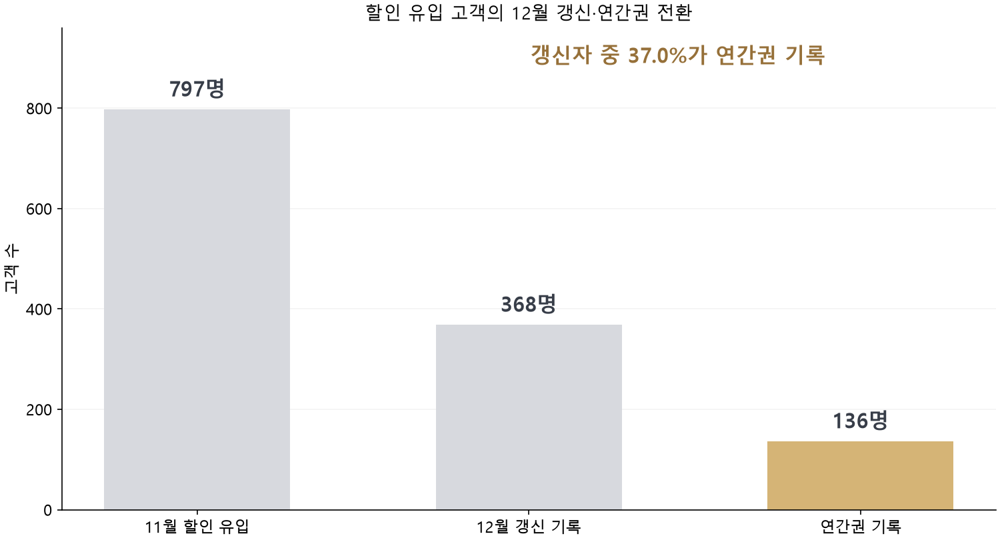
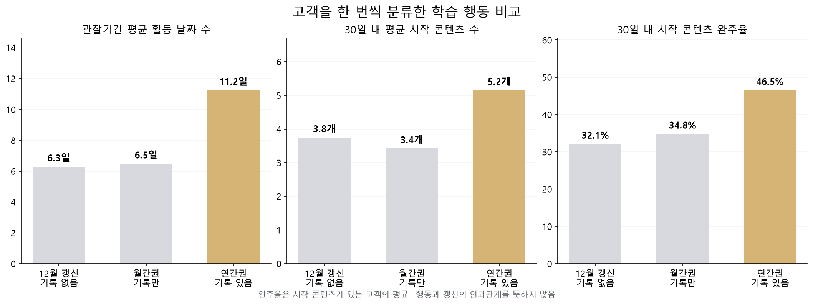

# 할인 유입 고객의 12월 갱신·연간권 전환 분석

**2022년 11월 할인 유입 고객 797명 중 368명이 12월에 갱신했고, 그중 136명(37.0%)에게 연간권 기록이 있었습니다. 고객군별 학습 행동을 비교해 연간권 안내 가설을 제안한 개인 프로젝트입니다.**

[분석 노트북](subscription_retention_analysis.ipynb) · [지표 정의](metric_notes.md) · [집계 결과](aggregate_results.json) · [모델 검토](model_review.md)



## 확인한 질문과 분석 대상

- 질문: 할인 유입 고객은 갱신과 연간권 전환에 따라 어떤 학습 행동 차이를 보일까?
- 대상: `plan15920_user_level_data.csv`의 2022년 11월 첫 결제·15,920원 플랜·할인 고객 797명
- 갱신 판정: 해당 고객의 2022년 12월 `renew_subscription` 기록
- 행동 비교: 첫 결제 후 30일 콘텐츠 시작·완료·경험 난이도와 제공된 30일 활동 지표
- 도구: Python, pandas, matplotlib. 기존 노트북의 Random Forest 등 모형 탐색은 별도 검토 문서로 설명했습니다.

## 핵심 결과와 분모

| 단계 | 고객 수 | 비율 |
|---|---:|---|
| 11월 할인 유입 | 797명 | 분석 코호트 전체 |
| 12월 갱신 기록 | 368명 | 할인 유입 고객의 **46.2%** |
| 12월 연간권 기록 | 136명 | 갱신 고객의 **37.0%**, 할인 유입 전체의 **17.1%** |

여기서 연간권 기록은 12월에 79,200원 플랜 갱신 기록이 한 번 이상 있다는 뜻입니다. 12월 최종 보유 상품이나 결제 직후 상태를 확정한 지표는 아닙니다.

## 고객을 한 번씩 분류한 행동 비교

| 그룹 | 고객 수 | 분류 기준 |
|---|---:|---|
| 12월 갱신 기록 없음 | 429명 | 해당 월 갱신 기록 없음. 서비스 탈퇴를 뜻하지 않음 |
| 월간권 기록만 | 232명 | 12월 월간권 기록이 있고 연간권 기록은 없음 |
| 연간권 기록 있음 | 136명 | 12월 연간권 기록이 있음 |

월간권과 연간권 기록이 모두 있는 13명은 연간권 기록 그룹에 한 번만 포함했습니다.



활동성과 콘텐츠 이용 차이를 고객군별로 확인했습니다. 콘텐츠 수·경험 난이도·완주율은 첫 결제 후 30일 범위로 다시 계산했습니다. 완주율은 같은 기간 시작한 고유 콘텐츠 중 완료 기록도 있는 콘텐츠의 비율이며, 시작 콘텐츠가 없는 고객은 미정의로 두었습니다.

활동 날짜 수와 최근 활동 간격은 제공된 30일 고객 마스터 값을 활용했습니다. 콘텐츠 로그 재계산 지표와 제공 지표의 출처를 [지표 정의](metric_notes.md)에 구분했습니다.

## 기존 숫자가 달랐던 이유

| 대상 | 11월 고객 | 12월 갱신 | 연간권 기록 |
|---|---:|---:|---:|
| 정상가·할인 고객 전체 | 886명 | 429명 | 144명 |
| **할인 고객만** | **797명** | **368명** | **136명** |

기존 자료의 `797 → 429 → 144`는 첫 단계와 뒤 단계의 대상이 달랐습니다. 공개본은 할인 고객만으로 통일했습니다. 전체 고객 기준의 `144 / 429 = 33.6%`와 할인 고객 기준의 `136 / 368 = 37.0%`를 구분합니다.

제공 마스터 전체의 정상가 고객 갱신율 63.15%, 할인 고객 갱신율 53.12%는 여러 달 고객을 합친 별도 요약입니다. 이때 마스터의 `renewed`는 12월 갱신 여부와 다른 정의이므로 위 퍼널과 연결하지 않습니다.

## 활용 제안과 해석 범위

학습 활동이 이어지고 여러 콘텐츠를 이용하는 고객에게 연간권 안내를 제공하는 가설을 제안했습니다. 실제로 활용하려면 안내 시점까지의 행동만 사용하고, 무작위 비교 실험으로 연간권 전환·비용·후속 유지율을 확인해야 합니다.

행동 차이는 인과효과가 아닙니다. 12월 갱신자 368명 중 91명은 30일 행동 관찰 종료 전에 이미 갱신했으므로, 이 비교를 미래 갱신 예측 성능이나 갱신 전 행동의 효과로 제시하지 않습니다. 원본 모형의 타깃·시간 범위를 검토한 내용은 [모델 검토](model_review.md)에 있습니다. 연간권 안내나 재구독 개선은 실제 실행 성과로 주장하지 않습니다.

## 파일과 실행 방법

- `subscription_retention_analysis.ipynb`: 문제 정의, 코호트 확인, 갱신 분류, 행동 비교, 해석과 제안
- `analysis.py`: 데이터 검증·고객 단위 결합·기간 제한·집계·그래프 생성
- `aggregate_results.json`: 사용자별 레코드를 제외한 재계산 결과
- `metric_notes.md`, `model_review.md`, `changes.md`: 지표·모형 검토·변경 내용

고객별 원본 CSV는 공개하지 않습니다. 데이터 접근 권한이 있는 환경에서 다음 구조로 파일을 두고 실행합니다.

```text
data/
  15920_1개월플랜_분석/plan15920_user_level_data.csv
  renew_subscription_df.csv
  start_content_df.csv
  end_content_df.csv
```

```bash
python -m pip install -r requirements.txt
python analysis.py
```

또는 이 폴더에서 노트북을 위에서 아래로 실행합니다. 데이터 폴더는 `SUBSCRIPTION_DATA_DIR` 환경변수로 지정할 수 있습니다. 원본이 없으면 전체 재실행은 불가능하며, 공개된 집계·그래프·실행된 노트북으로 분석 흐름을 확인할 수 있습니다.
